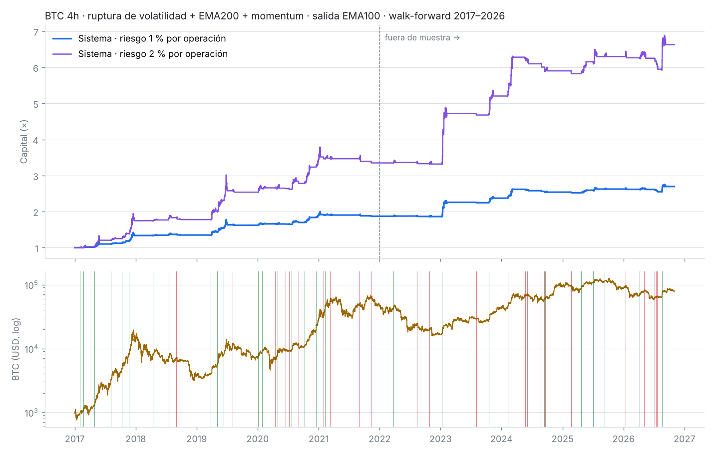
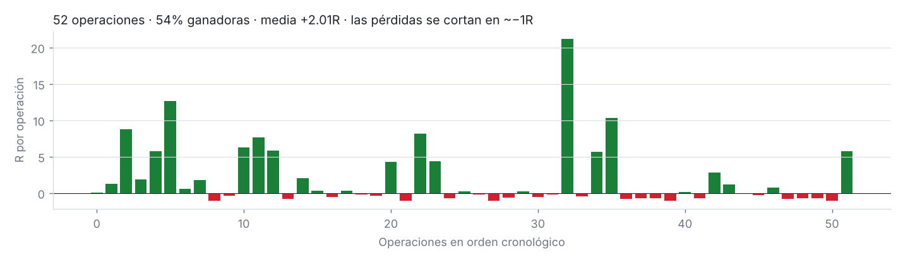

# Backtest · Ciclos + Volatilidad en BTC (2017–2026)

Este informe explica cómo se eligió la señal de `ciclos_volatilidad.pine`. Partimos de lo que ya
traían `time_cycles.pine` y `volatility_cycle.pine`, probamos cada pieza por separado y en
combinación, y nos quedamos solo con lo que se sostuvo **fuera de muestra**.

> **En una frase:** la parte de ciclos de tiempo no mejoró nada; lo que funciona es la ruptura
> tras compresión de volatilidad. Con el filtro de tendencia (EMA200), el checklist de momentum
> de la guía de ciclos y una salida por EMA100, en BTC 4h dio:
> - 52 operaciones;
> - +2,0R de media por operación;
> - factor de beneficio 7,7;
> - peor racha de pérdidas: −3,8R.
>
> Con ese mismo resultado, todavía no es garantía de nada: lee las [limitaciones](#7--limitaciones).

---

## 1 · Datos y método

| | |
|---|---|
| Activo | BTCUSD de Bitstamp (API pública `api/v2/ohlc`), velas 4h y 1D |
| Historia | 4h: jul-2016 → oct-2026 (22 547 velas) · 1D: ene-2014 → oct-2026 (4 688 velas) |
| Operado | desde el 1-ene-2017 (la historia anterior sirve para calentar indicadores y el motor de ciclos) |
| En muestra (IS) | 2017-01-01 → 2021-12-31. Aquí se elige todo: filtros, salidas y parámetros |
| Fuera de muestra (OOS) | 2022-01-01 → 2026-10-31. Solo se mira, no se elige nada con esto |
| Entrada | apertura de la vela siguiente a la señal |
| Stop | mínimo de la caja de compresión; si una vela toca stop y objetivo, cuenta el stop |
| Costes | 0,1 % por lado (0,2 % ida y vuelta), descontados en R |
| Riesgo mínimo | distancia al stop ≥ 0,5 × ATR (evita operaciones con stop ridículo que inflan el R) |
| Posiciones | una a la vez; sin piramidar |
| Unidad | **R** = lo que se arriesga en cada operación (entrada − stop) |

### Sin mirar el futuro (walk-forward)

- **Volatilidad, EMAs y momentum** se calculan vela a vela, igual que en Pine. No repintan.
- **Motor de ciclos** (anclas automáticas, subdivisión, ciclo dominante, ventanas de pivote):
  - se recalcula cada 30 velas en 4h y cada 5 en 1D;
  - cada recálculo usa **solo** los datos hasta ese momento, con un máximo de 5 000 velas, como en Pine;
  - su rejilla de pivotes se usa hasta el siguiente recálculo.

  En Pine el motor corre sobre todo el gráfico, en la última vela. Si se usara así en un
  backtest, vería pivotes que todavía no existían.
- **Hurst (R/S)** se calcula vela a vela con los rendimientos de las 100 velas anteriores.

---

## 2 · Lo que se probó de cada indicador

| Origen | Señal | Definición |
|---|---|---|
| `volatility_cycle.pine` | **VOL** | 1. Percentil del ATR(14) en 100 velas ≤ 5 (compresión).<br>2. Cruza por encima de 20 (liberación).<br>3. En ≤ 12 velas, el cierre sale de la caja de compresión (arriba → largo; abajo → corto). |
| `time_cycles.pine` | **CYC largo** | Dentro de la ventana del ciclo dominante, el cierre rompe la línea bajista trazada entre los dos últimos máximos descendentes. |
| `time_cycles.pine` | **CYC corto** | El cierre cruza por debajo de la VTL que une dos mínimos de ciclo válidos consecutivos. |
| `time_cycles.pine` | contexto | Fase del ciclo padre, ventana de pivote activa, fiabilidad del ciclo dominante y checklist de momentum. El checklist tiene tres puntos: EMA20/50 apiladas y separándose, ATR subiendo y volumen creciente. |
| `volatility_cycle.pine` | contexto | Exponente de Hurst > 0,5 o ≤ 0,5, y línea de ciclo de volatilidad (SMA90 del percentil del ATR28). |

Salidas probadas:
- objetivo de 2R;
- objetivo de 3R con stop a break-even;
- cierre bajo la EMA20, la EMA50 o la EMA100;
- salidas por ciclo: techo típico del ciclo y cambio a EMA20 tras un pico de volatilidad;
- tiempo máximo en todas las variantes.

---

## 3 · Iteraciones (BTC 4h)

Las tablas muestran:
- **n**: número de operaciones;
- **acierto**: porcentaje de operaciones ganadoras;
- **R/op**: R medio por operación;
- **PF**: factor de beneficio.

Todos los resultados ya llevan descontados costes y riesgo mínimo.

### Iteración 1 · Señales base

| Señal · salida | IS n | IS R/op | IS PF | OOS n | OOS R/op | OOS PF |
|---|---|---|---|---|---|---|
| VOL largo y corto · EMA20 | 74 | +0,31 | 2,33 | 97 | +0,28 | 2,11 |
| **VOL solo largo · EMA50** | 41 | **+1,13** | 5,66 | 47 | **+0,53** | 2,54 |
| VOL solo corto · EMA50 | 33 | −0,20 | 0,36 | 47 | −0,07 | 0,77 |
| CYC largo · EMA50 | 49 | +0,48 | 2,43 | 37 | **−0,33** | 0,14 |
| CYC corto · 2R | 16 | +0,04 | 1,08 | 6 | +0,47 | 4,25 |

**Lectura:**
- La ruptura de volatilidad **al alza** tiene ventaja en las dos mitades.
- Los cortos de volatilidad pierden dinero.
- Las señales de ciclos se derrumban fuera de muestra: el largo pasa de +0,48 a −0,33R. En
  corto apenas hay 6 operaciones.

### Iteración 2 · Fusiones directas (señal de volatilidad dentro de la fase del ciclo)

| Variante | IS R/op | OOS R/op |
|---|---|---|
| VOL largo dentro de la zona temprana del ciclo (−10 % … +35 %) · EMA20 | +1,18 | +0,39 |
| CYC largo solo tras una compresión de volatilidad reciente · EMA20 | +0,68 | **−0,26** |
| VOL corto en la fase de salida del ciclo (≥ 0,5) · EMA20 | −0,24 | +0,21 |

**Lectura:**
- Ninguna fusión supera a la ruptura de volatilidad sola fuera de muestra.
- Pedir que la ruptura caiga "en la fase buena del ciclo" sube el resultado en muestra, pero se
  pierde fuera.

### Iteración 3 · Filtros sobre VOL largo (salida EMA50)

| Filtro | IS n | IS R/op | OOS n | OOS R/op | OOS PF |
|---|---|---|---|---|---|
| ninguno | 41 | +1,13 | 47 | +0,53 | 2,54 |
| **precio > EMA200** | 35 | **+1,34** | 34 | **+0,88** | 3,70 |
| **momentum ≥ 2/3** (checklist de ciclos) | 36 | +1,27 | 36 | +0,69 | 3,07 |
| EMA20 > EMA50 | 27 | +1,28 | 33 | +0,86 | 3,61 |
| ciclo de volatilidad < 50 | 32 | +1,14 | 38 | +0,58 | 2,79 |
| Hurst > 0,5 | 38 | +1,23 | 43 | **+0,11** | 1,29 |
| ciclo de volatilidad subiendo | 17 | +1,26 | 16 | −0,05 | 0,87 |
| fase del ciclo < 0,5 ("entra dinero") | 22 | +0,92 | 26 | +0,67 | 2,78 |
| fase del ciclo ≥ 0,5 ("sale dinero") | 20 | +1,42 | 21 | +0,35 | 2,17 |
| ventana de pivote −10 % … +35 % | 18 | +1,21 | 24 | +0,59 | 2,48 |
| ciclo dominante fiable (≥ 60 % de aciertos) | 6 | +1,68 | 8 | +0,41 | 2,40 |

**Lectura:**
- Los filtros de **tendencia** (EMA200) y **momentum** son los únicos que mejoran en muestra y
  fuera.
- **Hurst > 0,5 empeora fuera de muestra:** pasa de +0,53 a +0,11R.
- Los filtros de fase del ciclo se contradicen entre sí:
  - en muestra gana la fase "sale dinero"; fuera, la fase "entra dinero";
  - con otra definición de fase (la mitad del ciclo padre, iteración 4) el resultado se invierte;
  - además dejan muy pocas operaciones.

  Eso es ruido, no una ventaja.

### Iteración 4 · Gestión y contexto de ciclos sobre "VOL largo + EMA200"

| Variante | IS n | IS R/op | OOS n | OOS R/op |
|---|---|---|---|---|
| base · EMA50 | 35 | +1,34 | 34 | +0,88 |
| **+ momentum ≥ 2 · EMA50** | 32 | **+1,43** | 27 | **+1,04** |
| + momentum · EMA50 → EMA20 tras pico de volatilidad | 32 | +0,83 | 27 | +0,79 |
| + momentum · salida en el techo típico del ciclo | 32 | +1,03 | 27 | +0,86 |
| + ciclo padre en su 1ª mitad | 17 | +1,51 | 18 | +1,76 |
| + ciclo padre en su 2ª mitad | 18 | +1,17 | 16 | −0,12 |
| + alguna ventana de pivote activa | 13 | +1,43 | 20 | +1,24 |
| + sin ventana activa | 22 | +1,28 | 16 | +0,22 |

**Lectura:**
- Las salidas basadas en ciclos o en volatilidad **cortan las tendencias demasiado pronto**.
- "Ciclo padre en su 1ª mitad" se ve bien fuera de muestra, pero en muestra su ventaja es mínima
  (+1,51 frente a +1,17), deja la mitad de operaciones y contradice el filtro de fase de la
  iteración 3. Elegirlo sería mirar el resultado OOS para decidir, así que **no se adopta**.
  Se muestra en el panel como contexto.

### Iteración 5 · Longitud de la EMA de salida (rejilla completa, ver §5)

| Salida | IS mediana R/op | OOS mediana R/op |
|---|---|---|
| EMA20 | +0,52 | +0,81 |
| EMA50 | +1,32 | +1,00 |
| **EMA100** | **+2,03** | **+1,49** |

La EMA100 gana en muestra y se confirma fuera.

### Iteración 6 · Tope de tiempo (salida forzada tras N velas)

El tope de 180 velas (30 días en 4h) se fijó de antemano, no se optimizó. Aun así, cierra **7 de
las 52 operaciones**, todas tendencias largas y ganadoras, así que conviene medir cuánto pesa.

| Salida | Tope | IS R/op | IS PF | OOS R/op | OOS PF | Cierres por tiempo |
|---|---|---|---|---|---|---|
| EMA100 | 90 velas | +1,37 | 5,7 | +1,19 | 3,9 | 22 |
| **EMA100** | **180 velas** | **+2,25** | **10,4** | **+1,71** | **5,6** | **7** |
| EMA100 | 270 velas | +2,63 | 12,0 | +1,51 | 5,0 | 2 |
| EMA100 | sin tope | +2,40 | 11,0 | +1,51 | 5,0 | 0 |
| EMA150 | 180 velas | +2,37 | 9,8 | +2,00 | 6,5 | 15 |
| EMA150 | 270 velas | +2,86 | 11,3 | +1,64 | 5,5 | 5 |
| EMA50 | cualquiera ≥ 180 | +1,43 | 6,7 | +1,04 | 4,2 | 0 |

**Lectura:**
- Un tope corto (90 velas) corta las tendencias y empeora todo.
- A partir de 180 velas, todas las variantes con EMA lenta caen en el mismo rango fuera de
  muestra: +1,5 a +2,0R/op.
- Si se hubiera optimizado en muestra, la elección habría sido EMA150 con tope de 270 velas, que
  fuera de muestra da +1,64R. Es un resultado equivalente.
- Se mantiene el valor fijado de antemano: EMA100 con tope de 180 velas. Los dos son ajustables en
  el indicador.
- El tope funciona como una toma de beneficios en tendencias maduras.

### Comparación final de candidatos (salida EMA50)

| Candidato | IS R/op | OOS R/op |
|---|---|---|
| A · VOL largo | +1,13 | +0,53 |
| B · A + momentum ≥ 2 | +1,27 | +0,69 |
| C · A + Hurst > 0,5 | +1,23 | +0,11 |
| D · B + Hurst > 0,5 | +1,45 | +0,14 |
| E · A + precio > EMA200 | +1,34 | +0,88 |
| F · CYC largo + momentum ≥ 2 | +1,05 | −0,15 |
| G · fusión: B o F | +1,11 | +0,51 |
| H · fusión: D o (F + Hurst) | +1,22 | +0,09 |

**Sistema elegido: E + momentum ≥ 2 con salida EMA100.**

---

## 4 · Sistema final

**Reglas:**
1. Compresión: percentil del ATR(14) en 100 velas ≤ 5.
2. Liberación: el percentil cruza por encima de 20.
3. Ruptura: en ≤ 12 velas, un cierre por encima del máximo de la caja.
4. Filtros: cierre > EMA200 y momentum ≥ 2 de 3.
5. Entrada a la apertura siguiente; stop en el mínimo de la caja (distancia ≥ 0,5 ATR).
6. Salida: cierre por debajo de la EMA100, o al cabo de 180 velas.

### Resultados BTC 4h

| Periodo | Ops | Acierto | R/op | PF | R total | Racha peor | CAGR al 1 % | Máx. DD al 1 % |
|---|---|---|---|---|---|---|---|---|
| IS 2017–2021 | 29 | 62 % | +2,25 | 10,4 | +65,2 | −2,4R | 13,4 % | 2,4 % |
| OOS 2022–2026 | 23 | 43 % | +1,71 | 5,6 | +39,3 | −3,8R | 7,8 % | 3,7 % |
| **Total** | **52** | **54 %** | **+2,01** | **7,7** | **+104,5** | **−3,8R** | **10,6 %** | **3,7 %** |

Otros datos:
- **Exposición:** en el mercado el 21 % del tiempo.
- **Duración mediana:** 74 velas (≈ 12 días).
- **Stop mediano:** 6,7 % del precio.





### Año por año

| Año | Ops | Acierto | R total | Resultado al 1 % de riesgo | BTC comprar y mantener |
|---|---|---|---|---|---|
| 2017 | 6 | 100 % | +30,3 | +33,7 % | +1 342 % |
| 2018 | 4 | 50 % | +0,9 | +0,9 % | −73 % |
| 2019 | 4 | 75 % | +19,0 | +20,1 % | +95 % |
| 2020 | 10 | 60 % | +17,3 | +18,2 % | +303 % |
| 2021 | 5 | 20 % | −2,4 | −2,4 % | +57 % |
| 2022 | 3 | 33 % | −0,5 | −0,5 % | −65 % |
| 2023 | 3 | 67 % | +26,3 | +27,4 % | +156 % |
| 2024 | 6 | 33 % | +7,3 | +7,0 % | +121 % |
| 2025 | 4 | 75 % | +3,4 | +3,4 % | −7 % |
| 2026 (a oct.) | 7 | 29 % | +2,9 | +2,7 % | −12 % |

El sistema **no tuvo ningún año peor que −2,4 %** al 1 % de riesgo, incluidos 2018 y 2022, cuando
BTC cayó más de un 60 %. A cambio, en los años alcistas gana mucho menos que mantener BTC.

Las 52 operaciones están en [`backtest/resultados/operaciones_4h.csv`](backtest/resultados/operaciones_4h.csv).

---

## 5 · ¿Es suerte? Dos pruebas

### Entradas al azar con las mismas reglas

Se hicieron 500 simulaciones con las mismas condiciones:
- mismo filtro (EMA200 + momentum ≥ 2);
- misma salida (EMA100);
- mismo stop típico (en ATR);
- mismo número de operaciones;
- pero entrando en velas **al azar** en lugar de en la ruptura.

| | Señal | Azar · mediana | Azar · percentil 90 | p |
|---|---|---|---|---|
| IS | +2,25R | +1,10R | +1,57R | 0,002 |
| OOS | +1,71R | +0,52R | +1,00R | < 0,002 |

Parte del resultado viene del **filtro + la salida**: en BTC, cualquier compra en tendencia con
salida por EMA lenta gana algo. La **ruptura de volatilidad añade de forma clara** sobre eso:
ninguna de las 500 simulaciones al azar la iguala fuera de muestra.

### Sensibilidad a los parámetros

Se probaron 81 combinaciones:
- compresión ≤ 3, 5 u 8;
- liberación > 15, 20 o 25;
- ventana de ruptura de 6, 12 o 24 velas;
- salida por EMA20, EMA50 o EMA100.

| | Combinaciones con R/op > 0 | Mediana | Peor |
|---|---|---|---|
| IS | 81 de 81 (100 %) | +1,32R | — |
| OOS | 81 de 81 (100 %) | +1,00R | +0,28R |

No hay un "punto mágico": cualquier ajuste razonable gana. Los valores por defecto (5 / 20 / 12 /
EMA100) no son los mejores de la rejilla fuera de muestra; son los que se eligieron en muestra.

---

## 6 · ¿Y los ciclos de tiempo?

Se miraron las 52 operaciones del sistema final según hubiera o no una ventana de pivote activa del
motor de ciclos en el momento de la señal:

| | n | Acierto | R/op |
|---|---|---|---|
| Con alguna ventana de pivote activa | 24 | 58 % | +2,23 |
| Sin ventana activa | 28 | 50 % | +1,82 |

La diferencia va en la dirección que predice Hurst (J.M.), pero con 24 frente a 28 operaciones y una
dispersión enorme no es significativa.

Por eso, en el indicador fusionado:
- los ciclos se **muestran como contexto**: el ciclo dominante, sus aciertos y la banda de la
  próxima ventana;
- **no bloquean ni activan** la señal.

Lo mismo con el exponente de Hurst (R/S): informa del régimen (tendencia o rango), pero como filtro
empeoró los resultados.

En **1D** la compresión ≤ 5 casi no ocurre: 1–2 operaciones en muestra y 5–10 fuera. Con tan pocas
operaciones no se puede validar nada; el patrón va en la misma dirección, pero no está probado. Las
señales de ciclos en 1D tampoco se sostienen fuera de muestra (CYC largo · EMA50: +4,79R con 14
operaciones en muestra → −0,35R con 9 fuera).

---

## 7 · Limitaciones

- **Una operación pesa mucho.** La de enero de 2023 dio +21R. Sin ella, la media fuera de muestra
  baja de +1,71 a ≈ +0,83R/op. Sigue siendo positiva, pero el sistema vive de pocas tendencias
  grandes y muchas pérdidas pequeñas: el 46 % de las operaciones pierde. Hay que poder aguantar
  rachas como la de 2021 (5 operaciones, 1 ganadora) o la de julio de 2026 (3 stops seguidos).
- **Pocas operaciones:** 52 en casi 10 años, unas 5 al año en 4h. Los intervalos de confianza son
  amplios.
- **Comprar y mantener BTC ganó mucho más** en este periodo: ×77 frente a ×2,7 con riesgo del 1 % y
  ×6,6 con riesgo del 2 %. El valor del sistema está en el riesgo: máx. DD del 3,7 % frente a caídas
  de más del 75 % de BTC. No es "ganar más que BTC".
- **Solo largos.** Los cortos de las dos fuentes no tuvieron ventaja en BTC.
- **Un activo y un timeframe validados:** BTC 4h. En otros activos o temporalidades, el panel
  "Backtest de este gráfico" del indicador da una primera idea, pero no es una validación
  walk-forward.
- **Ejecución:**
  - los resultados suponen 0,1 % de comisión por lado y ejecución a la apertura;
  - no incluyen financiación de futuros ni deslizamiento extra en velas de mucho volumen;
  - los gaps contra el stop se cuentan en el stop, que en cripto 24/7 es casi siempre así.
- **Datos de Bitstamp.** Otros exchanges tienen velas y volumen algo distintos. El filtro de volumen
  del momentum es el más sensible a eso.
- **Resultados pasados no garantizan resultados futuros.** Esto es material de estudio, no una
  recomendación de inversión.

---

## 8 · Cómo reproducirlo

Requisitos: Python 3.11+ con `numpy`, y `matplotlib` para los gráficos.

```bash
cd guias/ciclos-volatilidad/backtest

# (opcional) actualizar datos desde Bitstamp
python -I descargar_btc.py 4h datos/btc_4h.csv 2016-07-01
python -I descargar_btc.py 1d datos/btc_1d.csv 2014-01-01

python -I run.py datos 4h salida.json        # iteraciones 1-2: señales base y fusiones
python -I iterate.py datos 4h base           # iteración 1: señales base con 4 salidas
python -I iterate.py datos 4h filtros        # iteración 3: filtros
python -I iterate.py datos 4h gestion        # iteración 4: gestión y contexto de ciclos
python -I iterate.py datos 4h final          # comparación de candidatos A–H
python -I randtest.py datos 4h               # entradas al azar (señales base)
python -I sens.py datos 4h                   # rejilla de 81 combinaciones
python -I tope_tiempo.py datos 4h            # iteración 6: EMA de salida × tope de tiempo
python -I final.py datos 4h resultados       # sistema final + informe + prueba de azar
python charts.py resultados 4h               # gráficos
```

Archivos:

| Archivo | Contenido |
|---|---|
| `engine.py` | motor de ciclos de `time_cycles.pine` portado a Python |
| `vol.py` | volatilidad, caja de compresión, ruptura, momentum y Hurst de `volatility_cycle.pine` |
| `walk.py` | walk-forward del motor de ciclos, señales de ciclos y simulador de operaciones |
| `iteraciones/` | resultados JSON de cada iteración |
| `resultados/` | informe, operaciones y gráficos del sistema final |
